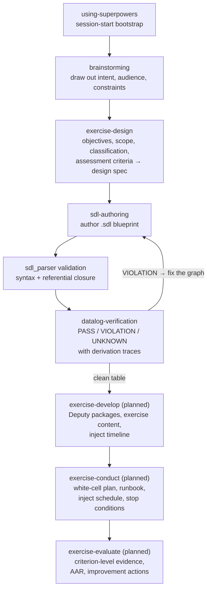
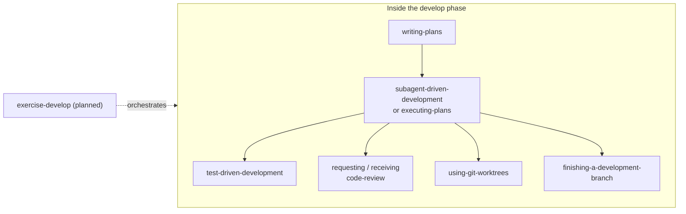

# Superpowers

Superpowers is a complete cyber range exercise development methodology for your coding agents, built on top of a set of composable skills and some initial instructions that make sure your agent uses them.

## Table of Contents

- [How it works](#how-it-works)
- [Getting Started](#installation)
  - [Claude Code](#claude-code)
  - [Antigravity](#antigravity)
  - [Codex App](#codex-app)
  - [Codex CLI](#codex-cli)
  - [Cursor](#cursor)
  - [Devin CLI](#devin-cli)
  - [Factory Droid](#factory-droid)
  - [Gemini CLI](#gemini-cli)
  - [GitHub Copilot CLI](#github-copilot-cli)
  - [Grok Build CLI](#grok-build-cli)
  - [Kimi Code](#kimi-code)
  - [OpenCode](#opencode)
  - [Pi](#pi)
  - [Qwen Code](#qwen-code)
  - [Hermes Agent](#hermes-agent)
  - [Muse](#muse)
- [The Exercise Lifecycle](#the-exercise-lifecycle)
  - [Order of execution](#order-of-execution)
  - [What triggers what](#what-triggers-what)
  - [Where the software skills fit](#where-the-software-skills-fit)
- [When Something Goes Wrong](#when-something-goes-wrong)
- [Community](#community)
- [What's Inside](#whats-inside)
- [Philosophy](#philosophy)
- [Contributing](#contributing)
- [Updating](#updating)
- [License](#license)
- [Visual companion telemetry](#visual-companion-telemetry)

## How it works

It starts from the moment you fire up your coding agent. As soon as it sees that you're building an exercise, it *doesn't* just jump into writing artefacts. Instead, it steps back and asks what the exercise is meant to teach and who it is for.

Once it has teased objectives, audience, scope, classification, and constraints out of the conversation, it writes a design spec and shows it to you in chunks short enough to actually read and digest.

After you've signed off on the design, your agent turns it into exercise artefacts — a scenario blueprint in SDL, Deputy packages, exercise content, and an inject timeline — validating each one before moving on. The blueprint must parse, package dependencies must resolve, and every learning objective must have at least one inject and one assessment criterion.

Next it writes the conduct plan — roles, inject schedule, escalation paths, and stop conditions — and after the exercise, the evaluation and after-action report. It's not uncommon for your agent to work autonomously through the artefact set without deviating from the plan you put together.

There's a bunch more to it, but that's the core of the system. And because the skills trigger automatically, you don't need to do anything special. Your coding agent just has Superpowers.

## Installation

Installation differs by harness. If you use more than one, install Superpowers separately for each one.

### Claude Code

#### Plugin Marketplace

This repository ships a Claude Code marketplace.

- Register the marketplace:

  ```bash
  /plugin marketplace add ncr-no/sdl-superpowers
  ```

- Install the plugin from this marketplace:

  ```bash
  /plugin install superpowers@superpowers-dev
  ```

### Antigravity

Install Superpowers as a plugin from this repository:

```bash
agy plugin install https://github.com/ncr-no/sdl-superpowers
```

Antigravity lists each installed skill's description, and the description of
the `using-superpowers` skill prompts the model to load that skill at the start
of a conversation. Reinstall with the same command to update.

### Codex App

Superpowers is available via the [official Codex plugin marketplace](https://github.com/openai/plugins).

- In the Codex app, click on Plugins in the sidebar.
- You should see `Superpowers` in the Coding section.
- Click the `+` next to Superpowers and follow the prompts.

### Codex CLI

Superpowers is available via the [official Codex plugin marketplace](https://github.com/openai/plugins).

- Open the plugin search interface:

  ```bash
  /plugins
  ```

- Search for Superpowers:

  ```bash
  superpowers
  ```

- Select `Install Plugin`.

### Cursor

- In Cursor Agent chat, install from marketplace:

  ```text
  /add-plugin superpowers
  ```

- Or search for "superpowers" in the plugin marketplace.

### Devin CLI

- Install the plugin from this repository:

  ```bash
  devin plugins install ncr-no/sdl-superpowers
  ```

- Update to the latest version with:

  ```bash
  devin plugins update superpowers
  ```

### Factory Droid

- Register the marketplace:

  ```bash
  droid plugin marketplace add https://github.com/ncr-no/sdl-superpowers
  ```

- Install the plugin:

  ```bash
  droid plugin install superpowers@superpowers
  ```

### Gemini CLI

- Install the extension:

  ```bash
  gemini extensions install https://github.com/ncr-no/sdl-superpowers
  ```

- Update later:

  ```bash
  gemini extensions update superpowers
  ```

### GitHub Copilot CLI

- Register the marketplace:

  ```bash
  copilot plugin marketplace add ncr-no/sdl-superpowers
  ```

- Install the plugin:

  ```bash
  copilot plugin install superpowers@superpowers-dev
  ```

### Grok Build CLI

Superpowers is available via the [official Grok plugin marketplace](https://github.com/xai-org/plugin-marketplace).

- Install the plugin from xAI's official marketplace:

  ```bash
  grok plugin install superpowers@xai-official --trust
  ```

- Or open the marketplace in the TUI, search for Superpowers, and install it:

  ```text
  /marketplace
  ```

### Kimi Code

Superpowers is available in Kimi Code's plugin marketplace.

- Open Kimi Code's plugin manager:

  ```text
  /plugins
  ```

- Go to `Marketplace` > `Superpowers` and install it.

- Or install directly from this repository:

  ```text
  /plugins install https://github.com/ncr-no/sdl-superpowers
  ```

- Detailed docs: [docs/README.kimi.md](docs/README.kimi.md)

### OpenCode

OpenCode uses its own plugin install; install Superpowers separately even if you
already use it in another harness.

- Tell OpenCode:

  ```
  Fetch and follow instructions from https://raw.githubusercontent.com/ncr-no/sdl-superpowers/refs/heads/main/.opencode/INSTALL.md
  ```

- Detailed docs: [docs/README.opencode.md](docs/README.opencode.md)

### Pi

Install Superpowers as a Pi package from this repository:

```bash
pi install git:github.com/ncr-no/sdl-superpowers
```

For local development, run Pi with this checkout loaded as a temporary package:

```bash
pi -e /path/to/superpowers
```

The Pi package loads the Superpowers skills and a small extension that injects the `using-superpowers` bootstrap at session startup and again after compaction. Pi has native skills, so no compatibility `Skill` tool is required. Subagent and task-list tools remain optional Pi companion packages.

### Qwen Code

Qwen Code installs plugins from Claude Code marketplaces directly.

- Install the plugin from this repository, and pick `superpowers` when prompted:

  ```bash
  qwen extensions install ncr-no/sdl-superpowers
  ```

- Update later:

  ```bash
  qwen extensions update superpowers
  ```

### Hermes Agent

Install Superpowers as a Hermes plugin from this repository:

```bash
hermes plugins install ncr-no/sdl-superpowers --enable
```

Restart any active Hermes sessions after installing. Note: Hermes has no
post-compaction hook, so a very long session that compacts over its first
turn loses the bootstrap — start a fresh session if skills stop triggering.

### Muse

Superpowers is available as a native Muse plugin — same repo, same skills, all harnesses. The `using-superpowers` bootstrap is injected via the native `SessionStart` hook alongside Claude Code, Codex, Cursor, Gemini, Pi, and the rest — no per-session opt-in.

- Install from a local checkout:

  ```bash
  muse plugins install ./
  muse plugins approve superpowers
  ```

  Or clone and install:

  ```bash
  git clone https://github.com/ncr-no/sdl-superpowers.git
  muse plugins install ./sdl-superpowers
  muse plugins approve superpowers
  ```

- Update later:

  ```bash
  muse plugins update superpowers
  ```

Restart any active Muse sessions after installing so the `SessionStart` hook takes effect — skills are active immediately, hooks require approval on first install. To verify, start a fresh session and send `Let's make a react todo list` — a working install auto-triggers `brainstorming` before any code is written. Version is tracked in `.version-bump.json` so `scripts/bump-version.sh` keeps it in sync.

## The Exercise Lifecycle

The methodology covers four phases, following the NIST SP 800-84 exercise lifecycle: **design**, **develop**, **conduct**, **evaluate**. Each phase is owned by a phase skill; artefact skills do the work inside a phase, and process skills govern how the agent works throughout. The `using-superpowers` bootstrap loads at session start and routes every task into this structure.



Solid nodes are shipped skills; **(planned)** nodes ship in later slices — until they exist, the agent walks the phase by hand and asks you for its inputs rather than substituting a software skill or inventing what the phase should produce.

### Order of execution

| # | Skill | Status | When it fires | Produces | Hands off to |
|---|---|---|---|---|---|
| 0 | `using-superpowers` | shipped | session start | the methodology, the stop-and-ask rule, skill routing | everything below |
| 1 | `brainstorming` | shipped | an exercise idea exists | a design brief you have corrected | `exercise-design` |
| 2 | `exercise-design` | shipped | brief agreed | design spec: objectives, audience, scope, classification, criteria | `sdl-authoring` |
| 3 | `sdl-authoring` | shipped | blueprint work begins | `.sdl` topology, accepted by `sdl_parser` | `datalog-verification` |
| 4 | `datalog-verification` | shipped | before anything builds against the blueprint | traceability table: PASS / VIOLATION / UNKNOWN per check | development — or back to the SDL with evidence |
| 5 | `writing-plans`, then `subagent-driven-development` or `executing-plans` | shipped | blueprint verified | build plan executed task-by-task, TDD throughout | `exercise-develop` (planned) |
| 6 | `deputy-packages` | planned (slice 3) | — | discovered, inspected, verified Deputy packages | |
| 7 | `exercise-content`, `inject-timeline` | planned (slice 4) | — | scenario narrative, parts, discussion questions, MSEL | |
| 8 | `exercise-conduct` | planned (slice 5) | — | white-cell plan, runbook, inject schedule, escalation | |
| 9 | `exercise-evaluate` | planned (slice 5) | — | criterion-level evidence, AAR, improvement actions | |

Verdict discipline: a check the facts cannot reach comes back **UNKNOWN**, never a quiet PASS — an UNKNOWN names what is missing and what would make it decidable.

### What triggers what

There is no registry — every harness scans `skills/*/SKILL.md` and routes on the `description:` frontmatter. In practice:

| You say | The agent runs |
|---|---|
| "We need an exercise on X" | `brainstorming` → `exercise-design` |
| "Build the blueprint" | `sdl-authoring` — validated before anything else proceeds |
| "Check the exercise hangs together" | `datalog-verification` |
| "Something is broken in the range" | `systematic-debugging`, then the relevant artefact skill |

Skills are invoked **before** any action, including clarifying questions. Objectives, audience, classification and stop conditions are never invented — the agent asks you.

### Where the software skills fit

Exercise artefacts are software (scenario services, Deputy packages, validation scripts), so software practices apply while building them — never as substitutes for a missing phase skill:



Cross-cutting at every phase: `verification-before-completion` gates hand-offs (PASS / VIOLATION / BLOCKED), `systematic-debugging` isolates faults in range environments and artefacts, `diagnosing-superpowers` works out what went wrong when a skill misfires, and `writing-skills` maintains this library.

## When Something Goes Wrong

Sometimes a session misbehaves: a skill fires when it shouldn't, stays silent when it should, or the agent ignores its plan, repeats work, or burns more tokens than you'd expect. Ask your coding agent to "figure out what went wrong with superpowers in this session" and it will invoke the **diagnosing-superpowers** skill. To examine an earlier session, name it: "figure out what went wrong with superpowers in session `<id>`".

The skill reads the session transcript, reports what happened with line-level evidence, and, if you want, packages a scrubbed bundle for a bug report.

## Community

- **Issues**: https://github.com/ncr-no/sdl-superpowers/issues

## What's Inside

### Skills Library

**Bootstrap**
- **using-superpowers** - Session-start bootstrap: the exercise methodology, the stop-and-ask rule, skill routing

**Lifecycle phases** *(one skill owns each phase; see [The Exercise Lifecycle](#the-exercise-lifecycle))*
- **exercise-design** - Elicits learning objectives, audience, scope, classification, and assessment criteria into a design spec *(shipped)*
- **exercise-develop** - Orchestrates blueprint, packages, content, and inject timeline *(planned, slice 4)*
- **exercise-conduct** - White-cell plan, runbook, inject schedule, escalation paths *(planned, slice 5)*
- **exercise-evaluate** - Criterion-level evidence, AAR, improvement actions *(planned, slice 5)*

**Artefact skills**
- **sdl-authoring** - Authors `.sdl` blueprints by hand and validates them through `sdl_parser` *(shipped)*
- **datalog-verification** - Stratified Datalog rule packs turn exercise facts into PASS / VIOLATION / UNKNOWN verdicts with derivation traces *(shipped)*
- **deputy-packages** - Discover, inspect, and verify Deputy packages; publishing stays a human step *(planned, slice 3)*
- **exercise-content** - Scenario narrative, parts, discussion questions *(planned, slice 4)*
- **inject-timeline** - Injects, triggers, MSEL ordering *(planned, slice 4)*

**Process skills** *(how the agent works while building artefacts)*
- **brainstorming** - Drawing out intent before building
- **writing-plans** - Detailed implementation plans
- **executing-plans** - Inline plan execution: one context, one final review
- **subagent-driven-development** - Fresh subagent per task with two-stage review (spec compliance, then code quality)
- **dispatching-parallel-agents** - Concurrent subagent workflows
- **test-driven-development** - RED-GREEN-REFACTOR cycle (includes testing anti-patterns reference)
- **using-git-worktrees** - Isolated development branches
- **requesting-code-review** - Pre-review checklist
- **receiving-code-review** - Responding to feedback
- **finishing-a-development-branch** - Merge/PR decision workflow
- **verification-before-completion** - Final gate: PASS / VIOLATION / BLOCKED

**Debugging and meta**
- **systematic-debugging** - 4-phase root cause process (includes root-cause-tracing, defense-in-depth, condition-based-waiting techniques)
- **diagnosing-superpowers** - Work out what went wrong in a session, with evidence; export a scrubbed bundle or file an issue
- **writing-skills** - Create new skills following best practices (includes testing methodology)

## Philosophy

- **Test-Driven Development** - Write tests first, always
- **Systematic over ad-hoc** - Process over guessing
- **Complexity reduction** - Simplicity as primary goal
- **Evidence over claims** - Verify before declaring success

## Contributing

The general contribution process for Superpowers is below. Keep in mind that we don't generally accept contributions of new skills and that any updates to skills must work across all of the coding agents we support. We also don't accept agent-written PRs that fix issues filed by someone else unless a maintainer asked for one, even when you hit the same problem; add your report to the existing issue instead.

1. Fork the repository
2. Switch to the 'dev' branch
3. Create a branch for your work
4. Follow the `writing-skills` skill for creating and testing new and modified skills
5. Submit a PR, filling in every section of the pull request template, including the summary a human writes in their own words.

Skill-behavior tests use the drill eval harness from [superpowers-evals](https://github.com/prime-radiant-inc/superpowers-evals/), cloned into `evals/` — see `evals/README.md` for setup. Plugin-infrastructure tests live at `tests/` and run via the relevant `run-*.sh` or `npm test`.

See `skills/writing-skills/SKILL.md` for the complete guide.

## Updating

Superpowers updates are somewhat coding-agent dependent, but are often automatic.

## License

MIT License - see LICENSE file for details

## Visual companion telemetry

Because skills and plugins don't provide any feedback to creators, we have no idea how many of you are using Superpowers. By default, the Prime Radiant logo on brainstorming's optional visual companion feature is loaded from our website. It includes the version of Superpowers in use. It does not include any details about your project, prompt, or coding agent. We don't see your clicks or anything about what you're building. This helps us have a rough idea of how many folks are using Superpowers and which version of Superpowers they're using. It's 100% optional. To disable this, set the environment variable `SUPERPOWERS_DISABLE_TELEMETRY` to any true value. Superpowers also honors Claude Code's `DISABLE_TELEMETRY` and `CLAUDE_CODE_DISABLE_NONESSENTIAL_TRAFFIC` opt-outs.
