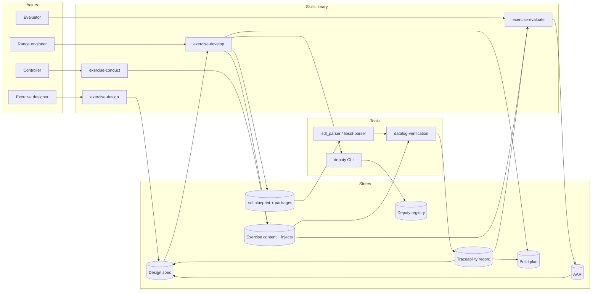
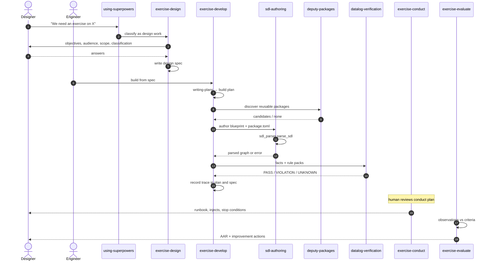
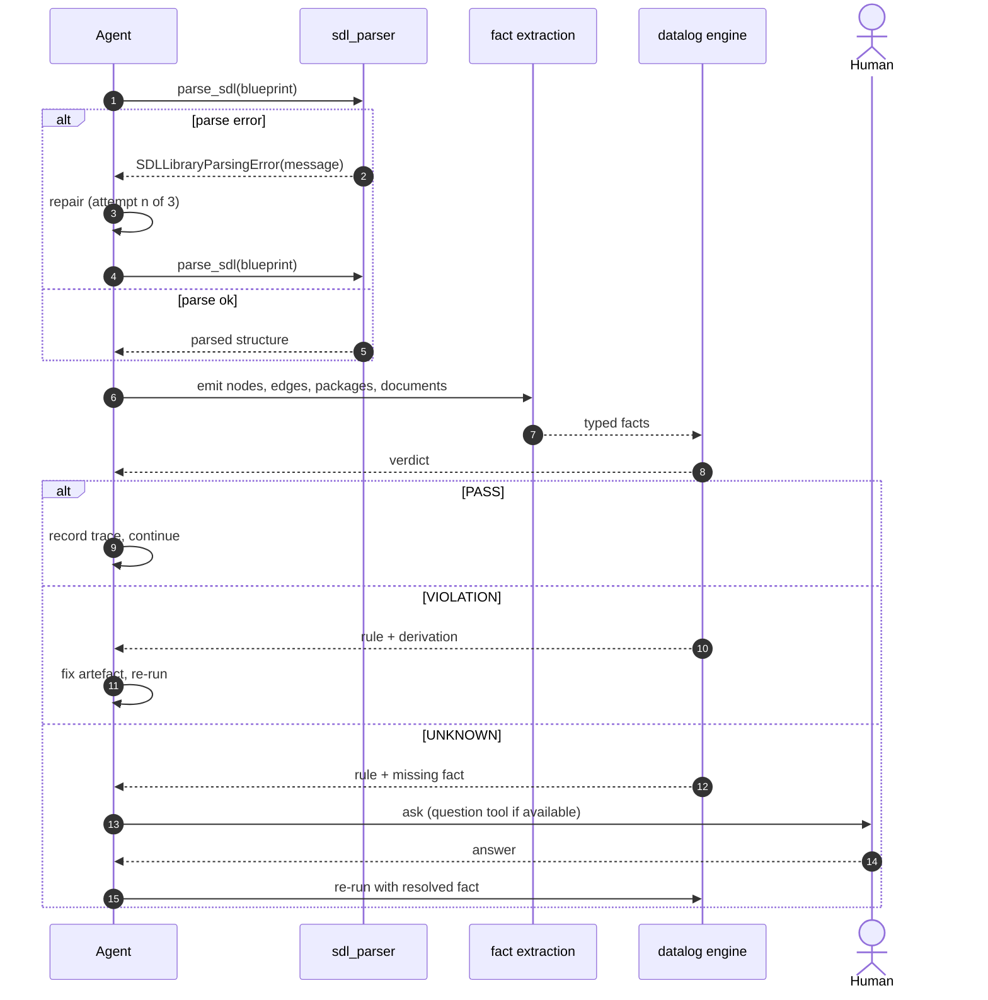
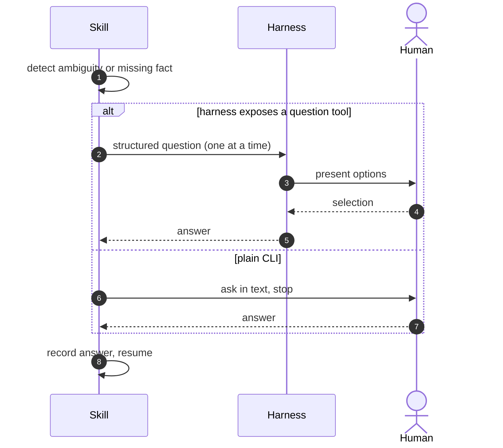

# Cyber Range Exercise Development Methodology — Design

**Date:** 2026-10-23
**Status:** Proposed
**Repository:** `ncr-no/sdl-superpowers`

## 1. Intent

This repository currently ships a software-development methodology: 15 skills that
move an agent from brainstorming through TDD, debugging, and code review. The goal
is a methodology for **cyber range exercise development** at NCR, covering the full
lifecycle:

> learning objectives → exercise design → artefact development → conduct → evaluation and AAR

The plugin mechanics stay: skill discovery, session-start bootstrap, per-harness
manifests. What changes is the methodology the skills encode.

### 1.1 Design brief

| Aspect | Decision |
|---|---|
| Primary users | The whole NCR exercise team — designers, range engineers, controllers, evaluators |
| Lifecycle coverage | Full: design, develop, conduct, evaluate |
| Methodology | Published exercise standard (NIST SP 800-84 test/training/exercise lifecycle; ENISA exercise guidance) |
| SDL authoring | Skills author `.sdl` and `package.toml` **natively**. `sdlgen` is never invoked |
| SDL validation | `sdl_parser.parse_sdl()` (the `sdl-parser` Python wrapper over `libsdl-parser`) |
| Deputy usage | Discover existing packages; inspect/verify newly generated ones. Publishing stays a human step |
| Verification | Datalog rules over SDL relationships, artefacts, and exercise documents |
| Question behaviour | Ask whenever the harness exposes a question tool; otherwise ask in plain text and wait |
| Granularity | Granular (24 skills) |
| Skill names | Existing 15 keep their identifiers; new skills get domain names |

### 1.2 Non-goals

- Invoking `sdlgen` generation or its repair loop.
- Publishing packages to the Deputy registry on the team's behalf.
- Replacing the range infrastructure tooling (ranger, OpenStack, Ansible).
- Renaming the plugin or the repository.

## 2. Impact analysis

All figures measured with `scripts/skill-metrics.sh` (introduced by slice 0) on
2026-10-23 at commit `5fa4940`.

### 2.1 Current state

| Skill | SKILL.md lines | Files | Software-keyword density | External files referencing it |
|---|---:|---:|---:|---:|
| subagent-driven-development | 336 | 14 | 9% | 35 |
| test-driven-development | 330 | 2 | 13% | 4 |
| executing-plans | 321 | 3 | 15% | 9 |
| writing-skills | 399 | 10 | 6% | 11 |
| brainstorming | 294 | 8 | 1% | 46 |
| systematic-debugging | 283 | 11 | 2% | 8 |
| finishing-a-development-branch | 225 | 1 | 35% | 7 |
| receiving-code-review | 205 | 1 | 6% | 3 |
| writing-plans | 204 | 1 | 10% | 8 |
| dispatching-parallel-agents | 167 | 1 | 3% | 4 |
| using-git-worktrees | 167 | 1 | 23% | 8 |
| diagnosing-superpowers | 120 | 20 | 3% | 5 |
| verification-before-completion | 120 | 1 | 5% | 3 |
| requesting-code-review | 95 | 2 | 23% | 6 |
| using-superpowers | 65 | 8 | 6% | 29 |
| **Total** | **3,331** | **84** | | |

Density is software-keyword hits (code, git, commit, branch, merge, pull
request, refactor, compile, lint, bug, debug, unit test, repository, repo) per
100 SKILL.md lines, rounded to the nearest percent — the figure
`scripts/skill-metrics.sh` prints. The reference column counts files outside
each skill's own directory; it was measured at commit `5fa4940`, so later
documentation (including this spec) raises today's counts. The
`using-superpowers` row is likewise the pre-rewrite measurement; slice 0
changes that skill to 88 lines.

### 2.2 What changes

| Category | Skills | Lines | Share | Nature |
|---|---|---:|---:|---|
| Reword (domain-neutral) | 9 | 2,026 | 61% | Vocabulary and worked examples; process survives |
| Re-scope (software → artefact) | 6 | 1,305 | 39% | Scope statement, examples, red-flag tables |
| New skills | 9 | ~2,600 est. | — | 4 phase skills, 4 artefact skills, 1 verification skill |
| Deleted skills | 0 | 0 | 0% | — |

Corpus: 3,331 → ~5,900 lines (+77%). Every existing SKILL.md is edited; 39% is
re-scoped rather than reworded. The 69 non-SKILL support files are reviewed per
skill; `brainstorming` (8 files) and `subagent-driven-development` (14 files) carry
the most domain-flavoured material.

### 2.3 Blast radius

| Area | Files | Impact |
|---|---:|---|
| Skill discovery | dynamic directory scan | Adding or renaming skills needs no configuration |
| Hardcoded `using-superpowers` | 3 | `hooks/session-start:20`, `.opencode/plugins/superpowers.js:121`, `.pi/extensions/superpowers.ts` |
| Bootstrap text | 1 line (`hooks/session-start:41`) | Highest-leverage edit in the migration |
| Tests | 47 of 70 files reference a skill name | Trigger fixtures and hooks assertions |
| Docs | 28 files | README per-harness installs, porting guide |
| Manifests | 7 plugin manifests + 2 marketplaces | Version and name only; no skill list |

### 2.4 Tooling gaps

Verified absent on the development machine:

| Tool | Status | Needed by |
|---|---|---|
| `sdl_parser` (Python) | not importable | `sdl-authoring`, `datalog-verification` |
| `libsdl-parser` shared library | not installed | `sdl_parser` |
| `deputy` CLI | not on PATH | `deputy-packages` |

Slice 2 and slice 3 must ship a detection step that reports the exact install
command and enters the `UNKNOWN` path instead of failing opaquely.

## 3. Architecture

### 3.1 Three tiers

```
┌─────────────────────────────────────────────────────────────┐
│ Core process (9, reworded)                                  │
│ bootstrap · brainstorming · plans · subagents · verification │
│ writing-skills · diagnosing-superpowers                      │
└───────────────────────────┬─────────────────────────────────┘
                            │ invoked by
┌───────────────────────────▼─────────────────────────────────┐
│ Lifecycle phases (4, new) — NIST SP 800-84                   │
│ exercise-design → exercise-develop → exercise-conduct        │
│                                  → exercise-evaluate         │
└───────────────────────────┬─────────────────────────────────┘
                            │ loads
┌───────────────────────────▼─────────────────────────────────┐
│ Artefacts (11)                                               │
│ new:  sdl-authoring · deputy-packages · exercise-content ·   │
│       inject-timeline · datalog-verification                 │
│ re-scoped: test-driven-development · systematic-debugging ·  │
│       requesting-code-review · receiving-code-review ·       │
│       using-git-worktrees · finishing-a-development-branch   │
└─────────────────────────────────────────────────────────────┘
```

### 3.2 Skill inventory (24)

| Tier | Skill | Role |
|---|---|---|
| Core | `using-superpowers` | Bootstrap: exercise methodology, stop-and-ask rule |
| Core | `brainstorming` | Turn an exercise idea into a design brief |
| Core | `writing-plans` | Build plan for exercise artefacts |
| Core | `executing-plans` | Execute the build plan |
| Core | `dispatching-parallel-agents` | Parallel authoring |
| Core | `subagent-driven-development` | Multi-agent build loop |
| Core | `verification-before-completion` | Final gate; PASS / VIOLATION / BLOCKED |
| Core | `writing-skills` | Maintain this library |
| Core | `diagnosing-superpowers` | Self-diagnosis when skills misfire |
| Phase | `exercise-design` | Objectives, audience, scope, classification, criteria |
| Phase | `exercise-develop` | Orchestrates artefact authoring and gates |
| Phase | `exercise-conduct` | White-cell plan, runbook, inject schedule, escalation |
| Phase | `exercise-evaluate` | Observation vs criteria, AAR, improvements |
| Artefact | `sdl-authoring` | Author `.sdl` / `package.toml`; validate via `sdl_parser` |
| Artefact | `deputy-packages` | Discover, inspect, verify packages |
| Artefact | `exercise-content` | Scenario narrative, parts, discussion questions |
| Artefact | `inject-timeline` | Injects, triggers, MSEL ordering |
| Artefact | `datalog-verification` | Invariant checking with derivation traces |
| Artefact | `test-driven-development` | Tests for scenario services and package logic |
| Artefact | `systematic-debugging` | Fault isolation in range environments and artefacts |
| Artefact | `requesting-code-review` | Request artefact review |
| Artefact | `receiving-code-review` | Act on artefact review |
| Artefact | `using-git-worktrees` | Scenario variants in isolated worktrees |
| Artefact | `finishing-a-development-branch` | Finish and hand off an artefact branch |

### 3.3 Routing

There is no registry. Every harness scans `skills/*/SKILL.md` and selects by the
`description:` frontmatter. The migration therefore has three control surfaces:

1. The bootstrap paragraph injected at session start, which frames every task as
   exercise development and names the four phases.
2. The `description:` of each skill, written with exercise-domain trigger language.
3. Cross-references between phase and artefact skills.

## 4. Use cases

### UC-1 — Design an exercise

**Actor:** Exercise designer.
**Precondition:** A topic or requirement exists; the target audience is known or
discoverable.
**Main flow:** The agent loads `exercise-design`, elicits learning objectives,
audience, scope, classification, and constraints one question at a time, proposes
the scenario premise, defines assessment criteria mapped to objectives, and writes
the design spec.
**Postcondition:** A design spec exists with objectives, criteria, classification,
and scope.
**Exceptions:** Objectives vague, audience unknown, classification unstated → stop
and ask (UC-6).

### UC-2 — Develop exercise artefacts

**Actor:** Range engineer.
**Precondition:** An approved design spec exists.
**Main flow:** `exercise-develop` loads `writing-plans`, then drives
`sdl-authoring`, `deputy-packages`, `exercise-content`, and `inject-timeline`. Each
artefact passes its validation gate before the next begins. `datalog-verification`
runs across the combined artefact set.
**Postcondition:** Validated blueprint, packages, content, and inject schedule with
a traceability record.
**Exceptions:** Parse failure → repair loop (max 3); missing package → `UNKNOWN` and
ask; tool absent → report install command and stop.

### UC-3 — Conduct the exercise

**Actor:** White cell / controller.
**Precondition:** Artefacts validated; environment deployed.
**Main flow:** `exercise-conduct` produces the runbook: roles, inject delivery
schedule, escalation path, stop conditions, contingency.
**Postcondition:** A conduct plan reviewed by a human.
**Exceptions:** Safety or stop condition ambiguous → stop and ask before conduct.

### UC-4 — Evaluate and produce the AAR

**Actor:** Evaluator.
**Precondition:** Conduct completed; observations and logs available.
**Main flow:** `exercise-evaluate` maps observations to criteria, cites the
traceability record, identifies gaps, and writes improvement actions.
**Postcondition:** AAR with criterion-level evidence and actions.

### UC-5 — Reuse or verify an existing package

**Actor:** Range engineer.
**Precondition:** Deputy registry reachable.
**Main flow:** `deputy-packages` searches the library, inspects candidate packages,
and either reuses them or authors a new package that is then inspected and verified.
**Postcondition:** Package referenced by the blueprint and recorded in the trace.

### UC-6 — Ask rather than guess

**Actor:** Any agent, any phase.
**Trigger:** Ambiguity, missing information, unresolvable dependency, or a rule
returning `UNKNOWN`.
**Main flow:** The agent asks one question — using the harness question tool when
available, otherwise plain text — and waits.
**Postcondition:** The human answers; work resumes with the answer recorded.

## 5. Data flow



Data crossing each boundary is JSON or Markdown: parse results from `sdl_parser`,
package metadata from `deputy`, facts and verdicts from the Datalog engine, and
document sections in the spec, plan, and AAR.

## 6. Sequence diagrams

### 6.1 Full lifecycle



### 6.2 Verification with repair and ask paths



### 6.3 Stop-and-ask



## 7. Verification model

### 7.1 Facts

| Source | Facts |
|---|---|
| `sdl_parser.parse_sdl()` | `node(id, type)`, `edge(a, rel, b)` |
| Deputy inspection | `package(id, version)`, `artifact(package, path, kind)`, `declared(package, dep)` |
| Exercise documents | `objective(id)`, `criterion(id, objective)`, `inject(id, targets)`, `assessment_maps(criterion, inject)` |

### 7.2 Rule groups

| Group | Invariants |
|---|---|
| structural | every service has a host; no orphan nodes; package dependency graph acyclic; every referenced package resolves in Deputy |
| scenario integrity | every inject targets an existing entity; inject timeline acyclic; every objective has at least one inject and one criterion |
| classification | segmentation between network classes; no cross-classification edge unless allowed; every host carries a classification |
| artefact integrity | declared dependencies present in `package.toml`; package contents match manifest; no credential or flag patterns in scenario artefacts |

### 7.3 Engine

Pure Python, no third-party dependencies: stratified Datalog with semi-naive
fixpoint, approximately 200 lines. Rules live in `references/rules/*.dl`; facts are
JSON. Graph sizes are tens to hundreds of nodes, so correctness of negation and
recursion matters more than throughput.

### 7.4 Outcomes

| Verdict | Meaning | Agent action |
|---|---|---|
| `PASS` | Rule satisfied | Record derivation in trace |
| `VIOLATION` | Rule refuted | Fix artefact, re-run |
| `UNKNOWN` | Rule undecidable — missing fact or tool | Stop and ask |

### 7.5 Traceability record

Written into both the exercise plan and the design spec:

| Rule | Status | Derivation / evidence | Artefact |
|---|---|---|---|
| `objective_has_assessment` | PASS | obj-2 → inject-4 → criterion-7 | scenario.sdl |
| `inject_target_exists` | VIOLATION | inject-9 targets host-14 (absent) | scenario.sdl |

The AAR cites this table rather than re-deriving what was checked.

## 8. Build slices

| Slice | Contents | Depends on |
|---|---|---|
| 0. Spine | Bootstrap rewrite, stop-and-ask and ask-tool rules, `scripts/skill-metrics.sh`, README/docs wording, hooks tests | — |
| 1. Design phase | `exercise-design`, `brainstorming` reword, trigger fixtures | 0 |
| 2. SDL and verification | `sdl-authoring`, `datalog-verification`, fact extraction, rule packs, evaluator, provisioning detection | 0 |
| 3. Deputy | `deputy-packages`, discovery and inspect flows, provisioning detection | 0 |
| 4. Develop | `exercise-develop`, `exercise-content`, `inject-timeline` | 1, 2, 3 |
| 5. Conduct and evaluate | `exercise-conduct`, `exercise-evaluate`, AAR ↔ traceability | 2, 4 |
| 6. Re-scope remainder | TDD, systematic-debugging, review skills, worktrees, finishing a branch; reword plans, subagents, verification, writing-skills, diagnosing | 0 |

Each slice gets its own implementation plan.

## 9. Testing

| Layer | Content |
|---|---|
| Structural gates | `tests/skill-size` (20 KB cut), shell lint — apply automatically |
| Trigger tests | One `tests/explicit-skill-requests/`-style fixture per new skill |
| Verification unit tests | Facts JSON → rules → verdicts, golden files, including `UNKNOWN` and deliberate violations |
| Acceptance drill | "Design a cyber range exercise on ransomware in a hospital network" through all phases, asserting artefacts and trace records |

## 10. Risks

| Risk | Mitigation |
|---|---|
| `libsdl-parser` and `deputy` absent | Detection step reports the install command and takes the `UNKNOWN` path |
| New skills never fire | Trigger fixture per slice, part of done |
| Corpus growth raises maintenance and compaction pressure | 20 KB gate; sometimes-needed content in `references/` |
| Software vocabulary leaks into exercise skills | Metrics script flags re-scoped skills above ~15% density |
| Harness question-tool differences | Portable ask-and-wait wording |

## 11. Decisions log

| Decision | Choice |
|---|---|
| Scope | Full lifecycle, one team |
| Structure | Lifecycle-first, three tiers |
| Methodology | Published standard |
| Granularity | Granular, 24 skills |
| Skill identifiers | Existing 15 keep their names |
| SDL generation | Never via `sdlgen`; author natively |
| Validation | `sdl_parser` / `libsdl-parser` |
| Deputy | Discovery and inspection only; publishing is human |
| Verification engine | Self-contained Python Datalog |
| Traceability | Records written into plan and spec |
| Questions | Ask whenever the harness supports it |
